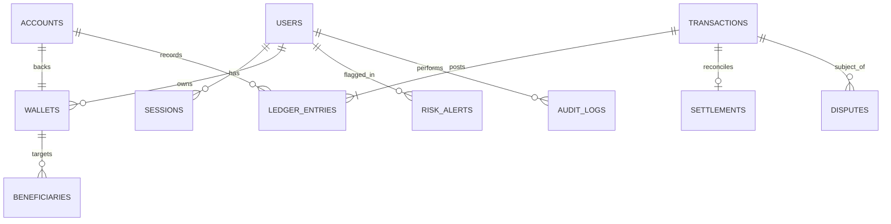

# FinCore Architecture, Data Ownership & ER Diagrams

## 1. High-Level System Architecture
```mermaid
flowchart LR
    U[Customer / Ops Browser] -->|HTTPS TLS 1.3| NG[Nginx Reverse Proxy]
    NG -->|/ | WEB[Next.js App Router Frontend :3000]
    NG -->|/api/v1/*| API[Node.js / Express Core API :4000]
    API -->|SQL Transactions / NUMERIC(19,4)| PG[(PostgreSQL 16 System of Record)]
    API -->|Cache / BullMQ Queues| RD[(Redis 7)]
    API -->|X-Service-Token Internal HTTP| AN[Python FastAPI Risk & Decimal Engine :8000]
    WK[Reconciliation Worker] --> PG
    WK --> RD
    WK --> AN
    PP[Sandbox Payment Provider] -->|HMAC-SHA256 Signed Webhook| API
```

## 2. Service Boundaries & Data Ownership
- **Core API (`apps/api`)**: Sole writer to PostgreSQL (`users`, `sessions`, `accounts`, `wallets`, `transactions`, `ledger_entries`, `holds`, `settlements`, `payment_intents`, `disputes`, `audit_logs`). Owns authentication, RBAC, idempotency, and double-entry posting.
- **Python Analytics Service (`services/analytics`)**: Stateless/bounded domain service owning `Decimal` fee/interest/reconciliation math and synthetic risk scoring. Never directly mutates ledger tables.
- **Frontend (`apps/web`)**: Presentation, client-side Zod UX validation, TanStack Query state management, and explicit `SIMULATED FUNDS` labeling. Never trusted as an authorization or balance boundary.

## 3. Double-Entry Ledger ER Diagram


## 4. Concurrency Control Trade-Offs
- **Pessimistic Deterministic Lock Ordering (`SELECT ... FOR UPDATE` / Keyed Mutex)**: Account IDs are sorted lexicographically prior to locking so concurrent transfers `A -> B` and `B -> A` never deadlock.
- **Optimistic Concurrency (`version` column)**: Clients may optionally pass `expectedSourceVersion` to detect concurrent balance changes (`409 OPTIMISTIC_LOCK_CONFLICT`).
- **Idempotency Keys**: Stored with a SHA-256 request payload hash; identical retries replay the original response, while modified payloads return `409 IDEMPOTENCY_CONFLICT`.
